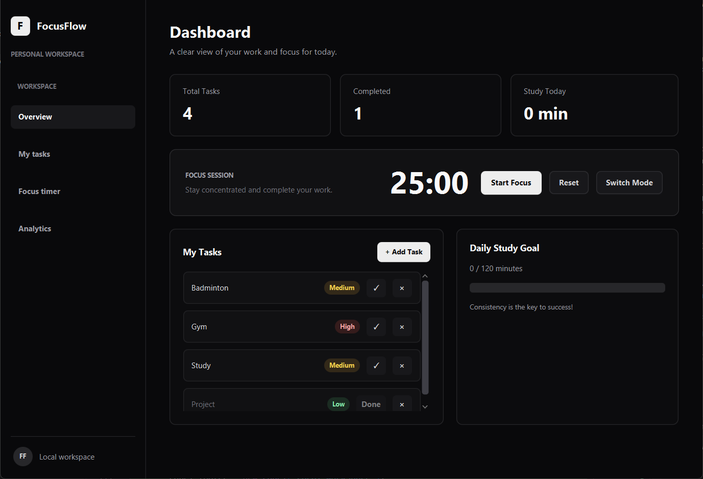
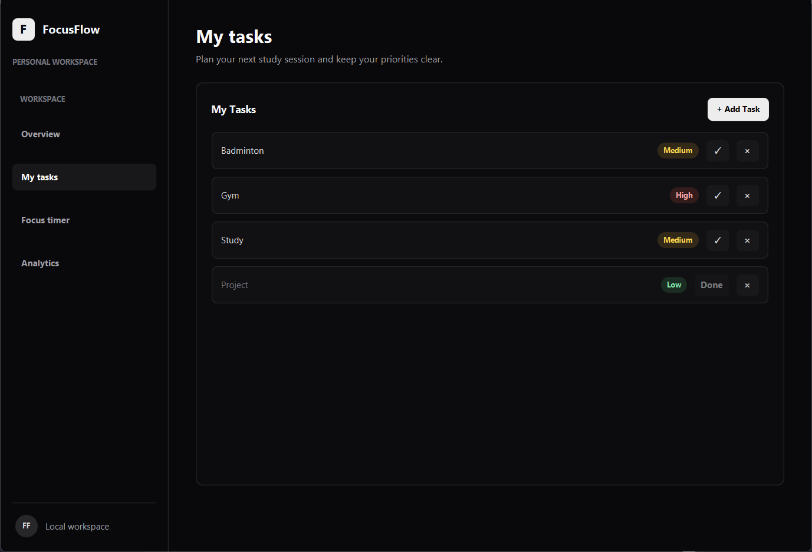
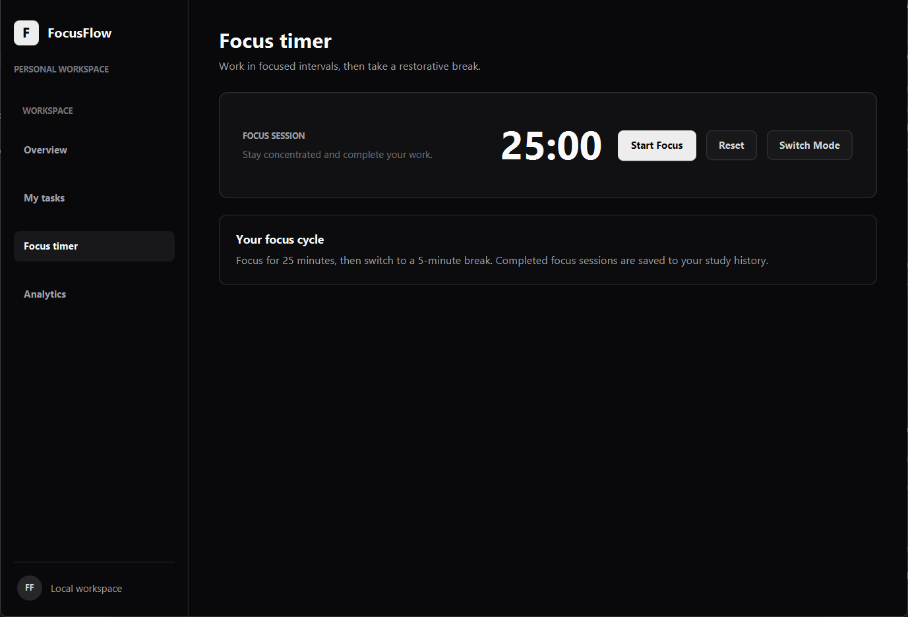
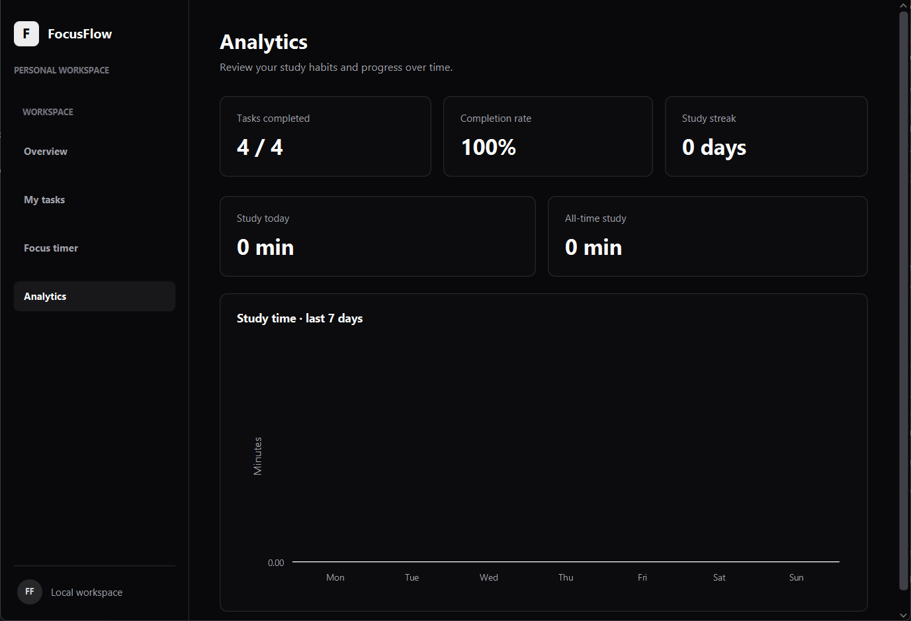

<div align="center">


# FocusFlow

**Plan your study. Protect your focus. See your progress.**

A desktop study planner and productivity tracker built with **Java**, **JavaFX**, and **SQLite**.

[Features](#features) · [Screenshots](#screenshots) · [Getting started](#getting-started) · [Project structure](#project-structure)

<br>


</div>

---

## Overview

FocusFlow brings everyday study planning into one focused desktop workspace. Organize tasks, work in timed focus sessions, set a daily study target, and review your progress—all in a lightweight JavaFX application.

Study data is stored locally with SQLite, so your tasks and sessions remain available between launches.

## Features

| | Feature | What it does |
|---|---|---|
| **01** | **Overview dashboard** | See your task counts, completed work, and study time at a glance. |
| **02** | **Task management** | Add, complete, and remove tasks; assign priorities to stay organized. |
| **03** | **Focus timer** | Use a Pomodoro-style 25-minute focus session and 5-minute break. Pause, resume, reset, or switch modes. |
| **04** | **Daily study goal** | Track your study time against a 120-minute daily target. |
| **05** | **Productivity summary** | Review your study activity and progress. |
| **06** | **Local persistence** | Store tasks and study sessions in an SQLite database. |

## Screenshots

<div align="center">

| Dashboard | Task manager |
|:---:|:---:|
|  |  |
| *Your daily overview* | *Plan and prioritize tasks* |

| Focus timer | Progress |
|:---:|:---:|
|  |  |
| *Stay focused in timed sessions* | *Keep an eye on your study goal* |

</div>

## Built with

- **Java 21** — application logic and object-oriented design
- **JavaFX 21** — desktop user interface
- **SQLite** — local data storage
- **JDBC** — database connectivity
- **Maven** — dependency and build management

## Getting started

### Prerequisites

- JDK 21 or later
- Maven 3.8+
- A desktop environment supported by JavaFX

### Run locally

```bash
# Clone the repository
git clone https://github.com/YOUR-USERNAME/FocusFlow.git
cd FocusFlow

# Launch the application
mvn clean javafx:run
```

The application creates its SQLite database (`focusflow.db`) automatically when it first runs. The database is stored locally and is not intended to be committed to the repository.

## Project structure

```text
FocusFlow/
├── src/
│   └── main/
│       ├── java/com/focusflow/
│       │   ├── Main.java
│       │   ├── FocusFlowApp.java
│       │   ├── Database.java
│       │   ├── Task.java
│       │   └── TaskDAO.java
│       └── resources/
│           └── style.css
├── docs/
│   └── screenshots/
├── .gitignore
├── pom.xml
├── LICENSE
└── README.md
```

## Data and privacy

FocusFlow uses a local SQLite database for application data. No account or cloud service is required. The generated database file is excluded from Git by `.gitignore`.

## Contributing

Suggestions and improvements are welcome. For substantial changes, open an issue first to discuss the proposal, then submit a pull request.

## License

Distributed under the MIT License. See [`LICENSE`](LICENSE) for details.

---

<div align="center">

**FocusFlow** · Built to make focused study a little easier.

</div>
